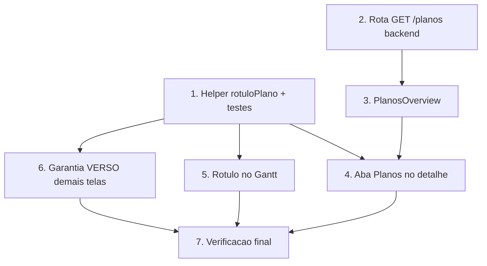

# Implementation Plan

## Overview

Plano de implementação da Spec A (itens 1–3 da reunião Carton Wega): helper de
rótulo "VERSO", rota de leitura de planos no backend, componente de
visualização de planos no detalhe da OP e rótulos de face/plano/2ª passada no
Gantt. Sem mudança de schema; abas atuais preservadas; nunca exibir "COSTA".

Ordem: primeiro o helper puro (base do Req 1, testável isolado), depois a rota
de leitura de planos no backend (habilita o Req 2), então as telas (detalhe da
OP e Gantt). Invariantes: nenhuma mudança de schema; abas atuais preservadas;
isolamento por `empresaId` via a OP; nunca exibir "COSTA".

## Tasks

- [x] 1. Helper de rótulo `rotuloPlano` + testes (frontend)
  - [x] 1.1 `src/lib/plano-rotulo.ts` com `rotuloPlano`/`rotuloComFace` (troca o
    token isolado "COSTA" via `\bcosta\b` por "VERSO", preserva o resto,
    null/""→""; idempotente).
  - [x] 1.2 `src/lib/plano-rotulo.test.ts` (vitest) cobrindo P1–P5 + múltiplas
    ocorrências. **8/8 passando**.
  - _Requisitos: 1.1, 1.2, 1.3, 1.4, 1.5_

- [x] 2. Rota de leitura de planos no backend (`VisioFab.Wms.Back`)
  - [x] 2.1 `GET /:id/planos` em `variacoes-entrega.routes.ts`: valida a OP por
    `{ id, empresaId }` (404), `planoOrdemProducao.findMany` por
    `ordemProducaoId`, `orderBy sequencia asc`, `select` explícito (incl.
    `pesoKg`/`aproveitamento`/`matriz` do schema real). Retorna
    `{ ordemProducaoId, planos, total }`.
  - [x] 2.2 `get_diagnostics` limpo; `prisma generate` OK. SEM schema/migração.
  - _Requisitos: 2.1, 2.2, 2.4_

- [x] 3. Componente `PlanosOverview` (frontend)
  - [x] 3.1 `src/components/pcp/PlanosOverview.tsx`: tabela por plano (seq.),
    nome via `rotuloPlano`, badge COMPONENTE (cyan) vs FACE (grape),
    formato/tiragem/cartão+gramatura/matriz com "—" quando ausente, badge
    "VERSO de <frente>" quando `faceDeId`, estado vazio e alerta
    não-bloqueante em dado incompleto.
  - [x] 3.2 `get_diagnostics` limpo.
  - _Requisitos: 2.1, 2.2, 2.3, 2.4, 2.5, 2.6, 2.7, 2.8, 4.5_

- [x] 4. Aba "Planos" no detalhe da OP (frontend)
  - [x] 4.1 `[id]/page.tsx`: carrega `GET /ordens-producao/:id/planos` (com
    `.catch` → []), nova aba "Planos" ({count}) com `<PlanosOverview>`, abas
    existentes preservadas; `rotuloPlano` aplicado na descrição das etapas.
  - [x] 4.2 `get_diagnostics` limpo.
  - _Requisitos: 2.1, 1.3, 1.5, 4.3, 4.4_

- [x] 5. Rótulo de face/plano/sequência no Gantt (frontend, 2 telas)
  - [x] 5.1 `pcp/gantt/page.tsx`: `faceDaDescricao` + `passada` por OP no
    centro; rótulo de face no texto da barra e no tooltip; badge "Nª" de 2ª+
    passada; `rotuloPlano` em tudo; barra sem face = render atual.
  - [x] 5.2 Mesmo em `pcp/timeline/gantt/page.tsx` (Req 3.7).
  - [x] 5.3 `get_diagnostics` limpo nas duas telas.
  - _Requisitos: 3.1, 3.2, 3.3, 3.4, 3.5, 3.6, 3.7, 4.1, 4.2_

- [x] 6. Garantia "VERSO" nas demais telas de PCP + orçamento (frontend)
  - [x] 6.1 `pcp/programacao/page.tsx`: função local `rotuloPlano` substituída
    pelo helper compartilhado (badges de plano já usavam). `PlanosDoItem.tsx`
    não tinha "COSTA" exibido (só comentário) — nada a trocar no corpo.
  - [x] 6.2 Varredura `git grep -in "costa"` em `pcp`/`components/pcp`: só
    comentários e o nome da spec `pcp-planos-frente-costa-rc` — nenhum texto de
    UI com "COSTA".
  - _Requisitos: 1.3, 1.5_

- [x] 7. Verificação final
  - [x] 7.1 `npm run build` (next build) do front: **✓ Compiled successfully**
    (todas as rotas de PCP geradas). Teste do helper (vitest) **8/8**. Backend
    `prisma generate` OK + diagnostics limpos.
  - [x] 7.2 Validação manual fica a cargo do usuário (abrir OP multi-plano
    3133/3143 e uma de retiração — aba Planos + Gantt).
  - _Requisitos: 2.1, 3.1, 4.1_

## Task Dependency Graph



```json
{
  "waves": [
    { "wave": 1, "tasks": ["1", "2"] },
    { "wave": 2, "tasks": ["3", "5", "6"] },
    { "wave": 3, "tasks": ["4"] },
    { "wave": 4, "tasks": ["7"] }
  ]
}
```

## Notes

- Sem mudança de schema. A rota do backend (Task 2) é leitura pura de
  `PlanoOrdemProducao`, isolada por `empresaId` via a OP.
- Backend e frontend são repos SEPARADOS: commits/pushes independentes na
  `main` de cada um. Backend deploya no Render; frontend na Vercel.
- Item 4 da reunião (travar/mover blocos no Gantt) é a Spec B — fora daqui.
- Nomenclatura exibida: SEMPRE "VERSO".
